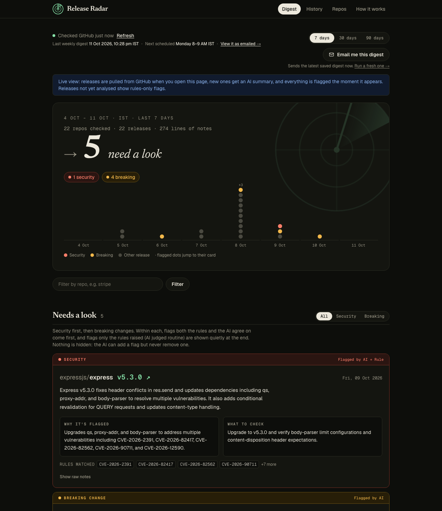
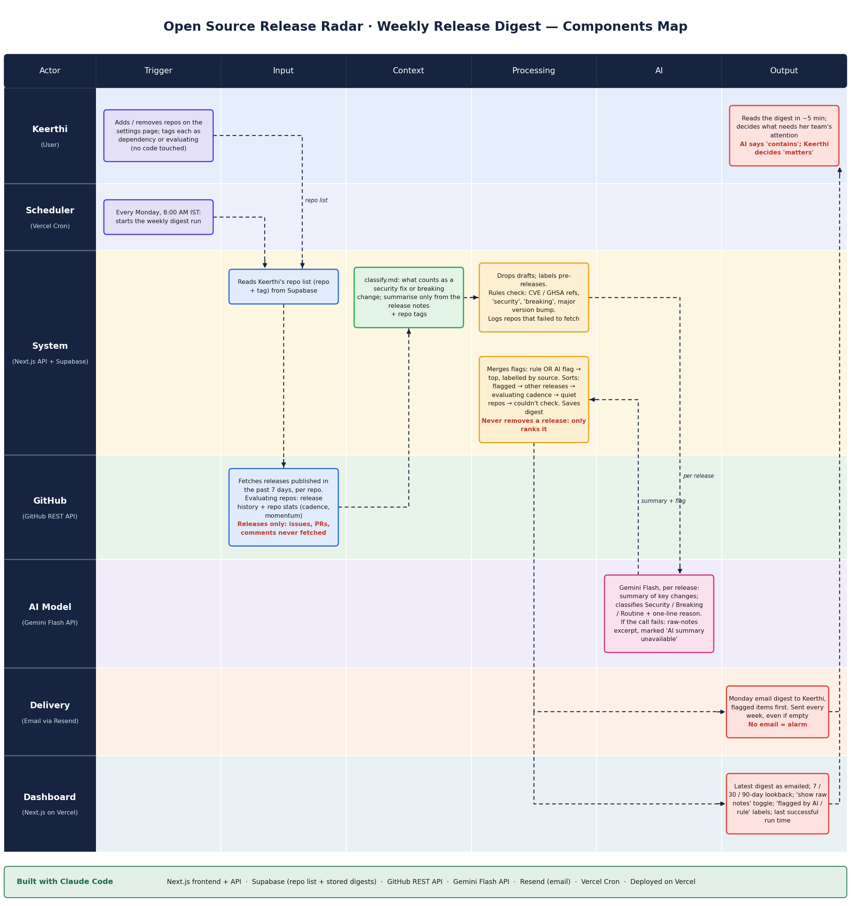

# Release Radar

**The problem.** Keerthi watches 20+ GitHub repos behind her fintech product. Notifications bury real releases under comments, PRs and commits, and a security patch once sat unread for 11 days.
**The fix.** A Monday-morning digest of what actually *shipped* in the past 7 days, with security fixes and breaking changes flagged at the top, readable in five minutes.
**The rules.** Releases only (never issues, PRs, comments or commits), nothing is ever hidden, and the repo list is editable without touching code.

- **Live app:** https://release-radar-eight.vercel.app
- **Source:** https://github.com/arza2010/release-radar-digest
- No Claude API is used in this app. AI tasks use **Gemini Flash** (`@google/genai`) only.



## What the AI does that rules can't

Rules match patterns: `CVE-…`, `GHSA-…`, the words *security* or *breaking*, and major version bumps. A change can be dangerous without using any of those words.

Real example from the live data, `getlago/lago` v1.54.0:

| | |
|---|---|
| **Release notes (excerpt)** | a list of PR titles, including “misc(events-processor): Remove flat filters and enriched expanded events” |
| **Rules** | no flag (no CVE, no keyword, not a major bump) |
| **Gemini Flash** | **breaking**: “Removes flat filters and enriched expanded events from events-processor.” Check: “Verify whether your events-processor implementation relies on flat filters or enriched expanded events before updating.” |

The same happened with `auth0/node-auth0` v7.3.0 (“…remove Organization Templates”): no keyword, but the AI flagged the removed feature.

The reverse also matters. `keycloak/keycloak` 26.8.0 has 90,000 characters of notes. The first CVE is at character 25,855, past the 6,000 characters the AI first saw, and it called the release routine. The rules caught the CVEs, the flag held (“Rule flagged; AI judged routine — check the notes”), and the fix was to also show the AI the security and breaking lines from the cut-off part. After that it classified the release as **security**.

## Results on the live data

Across the 22 tracked repos, last 30 days, every release that had notes (65 of the 69 stored; 4 had none):

| Flagged by | Releases |
|---|---|
| Rules and AI agree | 14 |
| **AI only** (the rules missed it) | **3** |
| Rules only (AI judged routine, flag kept) | 4 |
| Neither | 44 |

So the AI caught 3 breaking changes no keyword would find, the rules caught real CVEs the AI initially missed on very long notes, and the union is what you see. No flag was ever removed, none of the 69 releases ended with a failed analysis, and the whole set cost about a dozen Gemini calls (8 releases per call, cached by release id).

## AI / rules / human

| Part | Responsible for | Power |
|---|---|---|
| **AI** (Gemini Flash) | summary, category (security / breaking / routine), reason, suggested check | can add a flag, never remove one |
| **Rules** (`lib/rules.ts`) | CVE/GHSA ids, security and breaking keywords, major version bump, ordering, cadence | always runs, wins disagreements |
| **Human** (you) | deciding what matters to your product and what the team does | the AI only says what a release *contains* |

The principle: **the AI decides what to raise, never what to bury.**

## Architecture



1. **Vercel Cron** (Mon 02:30 UTC ≈ 08:00 IST) calls `GET /api/cron/weekly-digest`.
2. Load active repos from **Supabase**, fetch releases from the **GitHub REST API** (5 at a time).
3. Rules check (`lib/rules.ts`), then **Gemini Flash** for releases not already cached (`lib/gemini.ts`, `lib/analyze.ts`), batches of up to 8, cached by GitHub release id.
4. Merge (`lib/merge.ts`): `flagged = rules OR AI`. Build the digest (`lib/digest.ts`), save it, email it with **Resend**.
5. The **dashboard** (`/`) is live: when it opens (and every 10 minutes while it stays open) it pulls the last 7 days from GitHub, stores new releases, and gives genuinely new ones an AI summary. 30 and 90-day views are built from stored results. Every emailed digest stays viewable under **History**.
6. A second daily cron (`/api/cron/keepalive`) does a trivial read so the free Supabase project never pauses.

Stack: Next.js 16 (App Router, TypeScript, Tailwind), Supabase Postgres, GitHub REST API, Gemini Flash, Resend, Vercel Cron.

## Setup

```bash
npm install
cp .env.example .env.local        # fill in the values below
# In the Supabase SQL editor run: supabase/schema.sql   (then seed.sql, or `npm run seed`)
npm run dev
```

| Variable | What it is |
|---|---|
| `GITHUB_TOKEN` | personal access token, public-repo read-only |
| `GEMINI_API_KEY` | Google AI Studio key |
| `GEMINI_MODEL` | exact Flash model id (not Flash-Lite, not Pro) |
| `SUPABASE_URL` | project URL |
| `SUPABASE_SERVICE_ROLE_KEY` | the project's **secret** key (`sb_secret_…`), server only |
| `RESEND_API_KEY` | Resend key |
| `DIGEST_RECIPIENT` | must be the email the Resend account was created with (free plan limit) |
| `CRON_SECRET` | any long random string; Vercel sends it as `Authorization: Bearer …` to the cron routes |
| `APP_URL` | public URL, used for links in the email |

Secrets live only in environment variables. `.env*` is gitignored except `.env.example`. All database access is server-side, with row-level security enabled and no public policies.

### Useful scripts

| Command | What it does |
|---|---|
| `npm run check-repos` | check candidate repos against live GitHub |
| `npm run rules-digest` | print a rules-only digest (no AI) for 7 and 30 days |
| `npm run analyze -- --days 30` | analyse uncached releases (cached ones cost nothing) |
| `npm run build-digest` | run the whole pipeline and save a digest, no email |
| `npm run examples` | print real examples: notes · rules · AI verdict |
| `npm run preview-email` | write the latest digest as email HTML to `tmp-email/` |
| `npm test` | Vitest unit tests (88 cases) |

## Design decisions worth knowing

- **Quota-aware.** Free-tier Gemini quota is small, so releases are batched (8 per call), cached forever by release id, and a normal week uses about 4 calls. A daily cap and a manual-run cooldown guard the buttons.
- **Failures never hide a release.** A failed Gemini call shows the release with its notes excerpt and “AI summary unavailable”. A failed repo appears under “Couldn't check” with a plain reason.
- **Major-bump baseline.** A release is a major bump if its major version is higher than the highest earlier version with the same tag prefix (so a 4.x backport after 5.0.0 isn't misread). Every pre-release of a new major stays flagged.
- **Rule 9 revised, twice.** The original spec said visitors never trigger Gemini. With no login, “Run now” and “Backfill” are open. Opening the dashboard now also triggers a live GitHub pull and AI analysis of *new* releases only. All of it is bounded: a 5-minute throttle on live refreshes, at most 2 Gemini calls per refresh, a 20-call daily cap, a 10-minute cooldown on manual runs, and cached releases are never re-analysed. Viewing already-analysed data costs nothing.
- **Ordering inside “Needs a look.”** Security first, then breaking (as the spec says). Within each: flags the rules and AI agree on, then AI-only flags, then rule-only flags where the AI was unavailable, and last rule-only flags the AI judged routine (shown as quiet cards, never hidden). Newest first inside each tier.
- **Declutter without hiding.** Monorepo sub-package streams (3+ releases) and runs of pre-releases (2+) collapse into one line with a count; nothing is removed.
- **Optional “mark as reviewed.”** Run one line of SQL to switch it on (below).

## Optional: mark as reviewed (one SQL line)

The original problem was a security patch left unread for 11 days. To track that, run this once in the Supabase SQL editor:

```sql
alter table public.release_analysis add column if not exists reviewed_at timestamptz;
```

Nothing else to deploy. The app detects the column and switches on: every flagged release gets a “Mark as reviewed” button, and flagged releases from earlier weeks that nobody has reviewed reappear at the top of the next digest (dashboard and email) under **Still open from earlier weeks**. Reviewed releases stay visible (dimmed); marking never hides anything. Until the column exists, the app behaves exactly as before.

## Known limits

- Only changes published as **GitHub releases** are covered. Vendors that announce changes only on their own sites, and projects that only push tags (e.g. braintree_node, node-jsonwebtoken, passport), are not.
- If a maintainer fixes a vulnerability without saying so in the notes, no system reading the notes can detect it.
- Not real-time alerting. Data is pulled when someone opens the dashboard and on the Monday run, so a security fix published while nobody is looking is first seen at the next visit or in Monday's email. (GitHub webhooks would fix that, but they need admin rights on the repos you watch.)
- A release the AI fails to flag still appears, but lower down. Risk is reduced, not removed.
- Very long notes are only partly read (first 6,000 characters plus security/breaking lines from the rest).
- The rules are intentionally noisy, so expect some false alarms.
- Free-tier limits: Gemini quota, Vercel cron timing within the hour, Resend sending only to the account owner.
- No login: anyone with the link can edit the repo list or press “Run now”.
